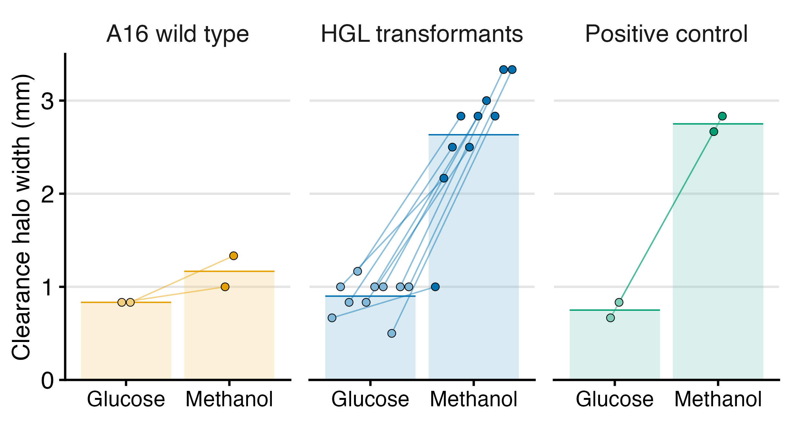

**Figure 1** Our transformants show a strong methanol-induced increase in lipase activity (halo width). Each line links a single colony patched onto both plates, showing the increase in clearance triggered by methanol. Bars show the group means. HGL expression is regulated by the methanol-inducible MOX promoter. The increase was significantly greater in transformed than in wild type yeast (Welch’s t = 5.44, d.f. = 4.7, p < 0.01), with mean increases of 1.73 mm in transformants (n = 10) and 0.33 mm in wild type (n = 2). The positive control (n = 2), transformed with pBlueHGL10, is included as a comparison and was not part of the test; all but one of our transformants matched its behaviour.
